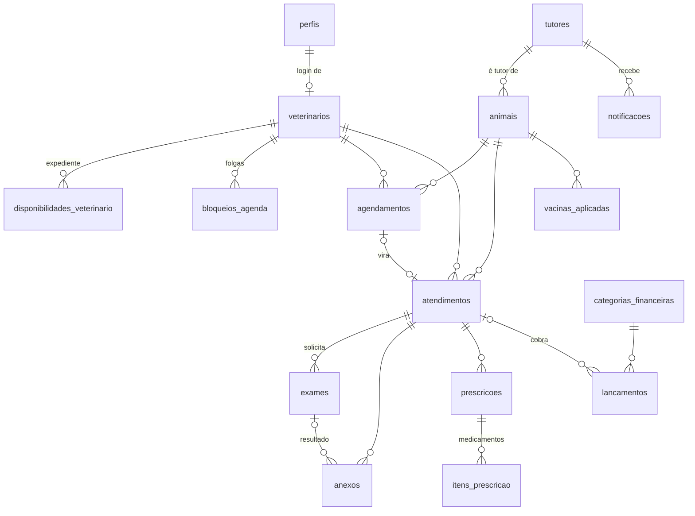

# Modelo de dados — AjuVet+

Banco PostgreSQL no Supabase. O SQL está em
[`supabase/migrations/20261015120000_modelo_inicial.sql`](../supabase/migrations/20261015120000_modelo_inicial.sql)
e os dados de exemplo em [`supabase/seed.sql`](../supabase/seed.sql).

## Diagrama



## Tabelas

| Área | Tabela | O que guarda | Requisito |
|---|---|---|---|
| Usuários | `perfis` | Nome e perfil (`recepcao` ou `veterinario`) de cada login do Supabase Auth | RF01 |
| Veterinários | `veterinarios` | Nome, CRMV, especialidade e contato | RF05 |
| | `disponibilidades_veterinario` | Expediente semanal (dia, hora inicial e final, duração do horário) | RF05 |
| | `bloqueios_agenda` | Férias, folgas e outros períodos sem atendimento | RF05 |
| Cadastros | `tutores` | Dados pessoais, contato e endereço | RF04 |
| | `animais` | Ficha do animal; cada animal tem um tutor | RF04 |
| Agenda | `agendamentos` | Consulta ou exame marcado para um animal com um veterinário | RF05 |
| Clínico | `atendimentos` | Sinais vitais, diagnóstico, procedimentos e observações | RF02 |
| | `exames` | Exames solicitados e resultados | RF02 |
| | `anexos` | Arquivos enviados ao bucket privado `anexos` do Storage | RF02 |
| | `vacinas_aplicadas` | Vacina, lote e data da próxima dose | RF02 |
| Prescrições | `prescricoes` | Receita de um atendimento, com orientações gerais | RF03 |
| | `itens_prescricao` | Medicamento, dose, frequência e duração | RF03 |
| | `notificacoes` | Fila de mensagens ao tutor (receita e lembretes), com horário de envio, destinatário e erro | RF03 |
| Financeiro | `categorias_financeiras` | Categorias de receita e despesa (já vêm cadastradas) | RF06 |
| | `lancamentos` | Receitas e despesas, com forma de pagamento e status | RF06 |

O histórico clínico (RF02) não tem tabela própria. Ele é a junção de `atendimentos`,
`exames`, `vacinas_aplicadas` e `prescricoes` do animal, em ordem de data.

## Regras garantidas pelo banco

- **Sem conflito de agenda:** um veterinário não pode ter dois agendamentos ativos no mesmo
  horário. Agendamentos cancelados ou com falta liberam o horário.
- **Expediente sem sobreposição:** o mesmo veterinário não pode ter dois expedientes que se
  cruzam no mesmo dia da semana.
- **Categoria certa:** um lançamento de receita só aceita categoria de receita, e o mesmo
  vale para despesa.
- **Pagamento completo:** um lançamento com status `pago` precisa ter `pago_em` e forma de
  pagamento.
- **Formatos:** CPF com 11 dígitos e CEP com 8 dígitos, só números. Valores, pesos e
  medidas precisam ser positivos.
- **Exclusão protegida:** não dá para apagar um tutor que tenha animais, nem um animal ou
  veterinário que tenha agendamentos ou atendimentos. Para tirar da lista, use `ativo = false`.
- `atualizado_em` é preenchido automaticamente em toda alteração.

## Segurança

O RLS está ligado em todas as tabelas, sem políticas. O backend conecta direto no PostgreSQL
como dono das tabelas, então não é afetado. No Supabase, isso garante que nada fique
exposto pela API pública (chave `anon`).

## Como aplicar

### Banco local (atual)

Veja o [README do backend](../backend/README.md#banco-de-dados-local). Em resumo:

```bash
python -m scripts.migrar --seed
```

O script roda antes o arquivo `backend/banco/compatibilidade_local.sql`, que cria o que o
Supabase já traz pronto (`auth.users`, `storage.buckets` e o schema `extensions`) e a tabela de
sessões do login local. Depois aplica, em ordem, as migrations que ainda não rodaram e registra
cada uma em `public.migracoes_aplicadas`.

### Supabase (futuro)

1. No **SQL Editor**, rode as migrations de `supabase/migrations` em ordem. **Não** rode o
   arquivo de compatibilidade local.
2. Troque a `DATABASE_URL` do backend pela conexão direta do projeto (Project Settings →
   Database).
3. Decida o login: continuar com o login próprio do backend (só falta criar `auth.sessoes`)
   ou passar para o Supabase Auth. As senhas já estão no mesmo formato bcrypt.
